<p align="center"><picture>
  <source media="(prefers-color-scheme: light)" srcset="docs/assets/hero-light.svg">
  
</picture></p>

<p align="center"></p>

<h1 align="center">BetterSound</h1>

<p align="center"><b>Un control de volumen para cada app, dentro del menú Sonido de Apple.</b><br>
BetterSound sustituye el ítem Sonido de la barra de menús y del Centro de control, se ve igual y añade volumen, silencio y salida por app.</p>

<p align="center">
  <a href="https://github.com/adrbn/bettersound/releases/latest/download/BetterSound.dmg"></a>
  <a href="#funciones"></a>
  <a href="#cómo-funciona"></a>
  <a href="https://ko-fi.com/adrbn"></a>
</p>

<p align="center">
  
  
  
  
  
</p>

<p align="center">Gratis y de código abierto · una alternativa gratuita a Native Sound Mixer · inglés y francés</p>

<p align="center"><sub><a href="README.md">English</a> · <a href="README.fr.md">Français</a> · <a href="README.de.md">Deutsch</a> · <b>Español</b> · <a href="README.it.md">Italiano</a> · <a href="README.ru.md">Русский</a> · <a href="README.zh-CN.md">简体中文</a></sub></p>

---

macOS tiene un solo volumen para todo. BetterSound da a cada app su propio control, su silencio y su salida, en el menú que ya usas: ocupa el lugar de Sonido en la barra de menús, se abre al pulsar Sonido en el Centro de control y copia el diseño de Apple hasta las filas de dispositivos. Sin controlador de audio, sin extensión del kernel, nada que configurar.

## Qué hace

<table>
  <tr>
    <td width="33%"><br><b>Un control por app</b><br>Cada app que suena tiene su fila.</td>
    <td width="33%"><br><b>Clic para silenciar</b><br>Pulsa el icono de una app.</td>
    <td width="33%"><br><b>Su propia salida</b><br>Una llamada en los AirPods, una película en los altavoces.</td>
  </tr>
  <tr>
    <td><br><b>Batería de los AirPods</b><br>Junto al dispositivo, como en Apple.</td>
    <td><br><b>El icono sigue la salida</b><br>Los mismos símbolos que el menú Sonido de Apple.</td>
    <td><br><b>Pequeño y nativo</b><br>Taps de Core Audio, SwiftUI, nada instalado en el sistema.</td>
  </tr>
</table>

## Funciones

**Por app**
- Un control de volumen para cada app que reproduce sonido. Los procesos auxiliares y reproductores de línea de comandos cuentan para la app que los lanzó.
- Pulsa el icono de la app para silenciarla, arrastra el control para recuperarla.
- Envía una app a otra salida con el botón al final de su fila. Si el dispositivo se desconecta, la app suena en la salida del sistema y vuelve cuando regresa.
- Las apps al 100 % en la salida del sistema no se tocan: sin tap, sin latencia.
- Volumen, silencio y salida se recuerdan por app.

**El menú Sonido de Apple, sustituido**
- Ocupa el lugar del ítem Sonido de Apple; el de Apple se oculta mientras BetterSound está abierto y vuelve al salir.
- Pulsar Sonido en el Centro de control abre BetterSound. El control de volumen y el botón AirPlay siguen funcionando.
- El icono muestra la salida (AirPods, altavoces, pantalla) o el nivel de volumen, como el de Apple.
- Lista de salidas con la batería Bluetooth y un enlace a Ajustes de Sonido.
- Panel Liquid Glass que sigue el modo claro y oscuro.

**La app**
- Se abre al iniciar sesión. Clic derecho en el icono: abrir al iniciar sesión, buscar actualizaciones, GitHub, Ko-fi y salir.
- Actualizaciones automáticas (Sparkle, firmadas con EdDSA).
- Inglés y francés.

## Instalación

1. Descarga [BetterSound.dmg](https://github.com/adrbn/bettersound/releases/latest/download/BetterSound.dmg). Está firmada con un Developer ID y notarizada por Apple.
2. Arrastra BetterSound a Aplicaciones y ábrelo.
3. Permite **Accesibilidad** cuando se pida y pulsa **Allow** en el panel para el audio del sistema.

Las actualizaciones llegan solas, o con clic derecho en el icono → **Check for Updates…**.

## Requisitos

- macOS 26 Tahoe o posterior.
- **Grabación de pantalla y audio del sistema**, para cambiar el volumen de cada app. No se graba ni se guarda nada.
- **Accesibilidad**, para abrirse desde el control Sonido del Centro de control.

## Cómo funciona

Los taps de proceso de Core Audio (`CATapDescription` con `.mutedWhenTapped`) silencian una app en origen; un dispositivo agregado privado reproduce su audio, escalado, en la salida elegida. Añade unos milisegundos de latencia, solo para las apps que cambiaste. Para el Centro de control, BetterSound lee su diseño mediante Accesibilidad y convierte un clic en el módulo Sonido en el panel de BetterSound.

Límite conocido: si cambias la salida fuera de BetterSound (botón AirPlay de Apple u otra app) mientras una app tiene su propio volumen, macOS puede volver atrás. Desde BetterSound funciona.

## Compilar desde el código

```bash
brew install xcodegen
make build                     # ad-hoc
make install TEAM=XXXXXXXXXX   # Developer ID → /Applications
make release TAG=v0.1.1        # notarized DMG + Sparkle appcast
```

macOS conserva el permiso de audio entre compilaciones solo para builds firmadas. Las imágenes del README salen de capturas reales: `python3 docs/assets/make_svgs.py`.

## Privacidad

BetterSound lee el audio solo para cambiar su volumen y reproducirlo. No se graba, guarda ni envía nada. La única petición de red es la búsqueda de actualizaciones en las versiones de este repositorio.

## Apoyo

BetterSound es gratis. Si te sirve, puedes invitarme a un café.

<p><a href="https://ko-fi.com/adrbn"></a></p>

## Licencia

MIT: úsalo, modifícalo, distribúyelo, conserva el aviso. Ver [LICENSE](LICENSE).

## Créditos

[Sparkle](https://sparkle-project.org) para las actualizaciones. Inspirado en Native Sound Mixer y el menú Sonido de Apple.

<sub>BetterSound no está afiliado a Apple ni a Native Sound Mixer. macOS, AirPods y Centro de control son marcas de Apple Inc.</sub>
