<picture>
  <source media="(prefers-color-scheme: light)" srcset="docs/assets/hero-light.svg">
  
</picture>

<p align="center"></p>

<p align="center"><b>Un curseur de volume pour chaque app, dans le menu Son d'Apple.</b><br>
BetterSound remplace l'élément Son de la barre des menus et du Centre de contrôle, garde son apparence, et ajoute le volume, la sourdine et la sortie par app.</p>

<p align="center">
  <a href="https://github.com/adrbn/bettersound/releases/latest/download/BetterSound.dmg"></a>
  <a href="#fonctions"></a>
  <a href="#comment-ça-marche"></a>
  <a href="https://github.com/adrbn/bettersound"></a>
</p>

<p align="center">
  
  
  
  
  
</p>

<p align="center">Gratuit et open source · une alternative gratuite à Native Sound Mixer · anglais et français</p>

<p align="center"><a href="README.md">English</a> · <b>Français</b></p>

---

macOS n'a qu'un volume pour tout. BetterSound donne à chaque app son curseur, sa sourdine et sa sortie, dans le menu que vous utilisez déjà : il prend la place de Son dans la barre des menus, s'ouvre quand vous cliquez sur Son dans le Centre de contrôle, et reprend la mise en page d'Apple jusqu'aux lignes des appareils. Pas de pilote audio, pas d'extension du noyau, rien à configurer.

## Ce qu'il fait

<table>
  <tr>
    <td width="33%"><br><b>Un curseur par app</b><br>Chaque app qui joue a sa ligne.</td>
    <td width="33%"><br><b>Un clic pour couper</b><br>Cliquez sur l'icône d'une app pour la couper.</td>
    <td width="33%"><br><b>Sa propre sortie</b><br>Un appel dans les AirPods, un film sur les haut-parleurs.</td>
  </tr>
  <tr>
    <td><br><b>Batterie des AirPods</b><br>À côté de l'appareil, comme chez Apple.</td>
    <td><br><b>L'icône suit la sortie</b><br>Les mêmes symboles que l'élément Son d'Apple.</td>
    <td><br><b>Léger et natif</b><br>Taps Core Audio, SwiftUI, rien d'installé dans le système.</td>
  </tr>
</table>

## Fonctions

**Par app**
- Un curseur de volume pour chaque app qui joue du son. Les processus auxiliaires et les lecteurs en ligne de commande comptent pour l'app qui les a lancés.
- Cliquez sur l'icône de l'app pour la couper, faites glisser le curseur pour la rétablir.
- Envoyez une app vers une autre sortie avec le bouton au bout de sa ligne. Si l'appareil se déconnecte, l'app joue sur la sortie du système et y retourne quand il revient.
- Une app laissée à 100 % sur la sortie du système n'est pas touchée du tout : pas de tap, pas de latence.
- Volumes, sourdines et sorties sont mémorisés pour chaque app.

**Le menu Son d'Apple, remplacé**
- Prend la place de l'élément Son d'Apple dans la barre des menus ; celui d'Apple est masqué tant que BetterSound tourne et revient quand vous le quittez.
- Cliquer sur Son dans le Centre de contrôle ouvre BetterSound à sa place. Le curseur de volume et le bouton AirPlay y fonctionnent toujours.
- L'icône de la barre des menus montre la sortie (AirPods, haut-parleurs, écran) ou le niveau du volume, comme celle d'Apple.
- Liste des sorties avec la batterie des appareils Bluetooth, et un lien vers Réglages Son.
- Panneau en Liquid Glass qui suit le mode clair et le mode sombre.

**L'app**
- S'ouvre au démarrage. Clic droit sur l'icône : Ouvrir au démarrage, Rechercher des mises à jour, GitHub, Ko-fi et Quitter.
- Mises à jour automatiques (Sparkle, signées EdDSA).
- Anglais et français.

## Installation

1. Téléchargez [BetterSound.dmg](https://github.com/adrbn/bettersound/releases/latest/download/BetterSound.dmg). Il est signé avec un Developer ID et notarisé par Apple.
2. Glissez BetterSound dans Applications et ouvrez-le.
3. Autorisez **Accessibilité** quand macOS le demande, puis cliquez sur **Autoriser** dans le panneau pour l'audio du système.

Les mises à jour arrivent seules. Vous pouvez aussi faire un clic droit sur l'icône et choisir **Rechercher des mises à jour…**.

## Configuration requise

- macOS 26 Tahoe ou plus récent.
- **Enregistrement de l'écran et de l'audio du système**, pour changer le volume de chaque app. Rien n'est enregistré ni conservé.
- **Accessibilité**, pour s'ouvrir depuis le bouton Son du Centre de contrôle.

## Comment ça marche

Les taps de processus Core Audio (`CATapDescription` avec `.mutedWhenTapped`) coupent une app à la source ; un périphérique agrégé privé rejoue son audio, à son volume, sur la sortie choisie. Cela ajoute quelques millisecondes de latence, seulement pour les apps que vous avez réglées. Le crochet du Centre de contrôle lit sa mise en page via l'Accessibilité et transforme un clic sur la tuile Son en panneau BetterSound.

Limite connue : si vous changez de sortie en dehors de BetterSound (bouton AirPlay d'Apple ou une autre app) pendant qu'une app a son propre volume, macOS peut revenir en arrière. Le changement depuis BetterSound fonctionne.

## Compiler depuis les sources

```bash
brew install xcodegen
make build                     # signature ad hoc
make install TEAM=XXXXXXXXXX   # signé Developer ID, copié dans /Applications
make release TAG=v0.1.1        # DMG notarisé + appcast Sparkle sur GitHub Releases
```

macOS ne garde l'autorisation audio d'une compilation à l'autre que pour une version signée. Les visuels du README sont générés à partir de vraies captures : `python3 docs/assets/make_svgs.py`.

## Confidentialité

BetterSound lit l'audio seulement pour en changer le volume et le rejouer. Rien n'est enregistré, conservé ni envoyé. La seule requête réseau est la recherche de mises à jour dans les versions de ce dépôt.

## Soutenir

BetterSound est gratuit. S'il vous sert, vous pouvez m'offrir un café ou mettre une étoile au dépôt.

<p>
  <a href="https://ko-fi.com/adrbn"></a>
  <a href="https://github.com/adrbn/bettersound"></a>
</p>

## Licence

MIT : utilisez-le, modifiez-le, distribuez-le, gardez la mention. Voir [LICENSE](LICENSE).

## Crédits

[Sparkle](https://sparkle-project.org) pour les mises à jour. Inspiré de Native Sound Mixer et du menu Son d'Apple.

<sub>BetterSound n'est affilié ni à Apple ni à Native Sound Mixer. macOS, AirPods et Centre de contrôle sont des marques d'Apple Inc.</sub>
