<p align="center"><picture>
  <source media="(prefers-color-scheme: light)" srcset="docs/assets/hero-light.svg">
  
</picture></p>

<p align="center"></p>

<h1 align="center">BetterSound</h1>

<p align="center"><b>Un cursore del volume per ogni app, dentro il menu Suono di Apple.</b><br>
BetterSound sostituisce la voce Suono nella barra dei menu e nel Centro di Controllo, ha lo stesso aspetto e aggiunge volume, silenzioso e uscita per app.</p>

<p align="center">
  <a href="https://github.com/adrbn/bettersound/releases/latest/download/BetterSound.dmg"></a>
  <a href="#funzioni"></a>
  <a href="#come-funziona"></a>
  <a href="https://ko-fi.com/adrbn"></a>
</p>

<p align="center">
  
  
  
  
  
</p>

<p align="center">Gratuito e open source · un'alternativa gratuita a Native Sound Mixer · 23 lingue</p>

<p align="center"><sub><a href="README.md">English</a> · <a href="README.fr.md">Français</a> · <a href="README.de.md">Deutsch</a> · <a href="README.es.md">Español</a> · <b>Italiano</b> · <a href="README.ru.md">Русский</a> · <a href="README.zh-CN.md">简体中文</a></sub></p>

---

macOS ha un solo volume per tutto. BetterSound dà a ogni app il suo cursore, il suo silenzioso e la sua uscita, nel menu che usi già: prende il posto di Suono nella barra dei menu, si apre quando clicchi su Suono nel Centro di Controllo e copia il layout di Apple fino alle righe dei dispositivi. Nessun driver audio, nessuna estensione del kernel, niente da configurare.

## Cosa fa

<table>
  <tr>
    <td width="33%"><br><b>Un cursore per app</b><br>Ogni app che suona ha la sua riga.</td>
    <td width="33%"><br><b>Clic per silenziare</b><br>Clicca sull'icona di un'app.</td>
    <td width="33%"><br><b>La sua uscita</b><br>Una chiamata sugli AirPods, un film sugli altoparlanti.</td>
  </tr>
  <tr>
    <td><br><b>Batteria degli AirPods</b><br>Accanto al dispositivo, come da Apple.</td>
    <td><br><b>L'icona segue l'uscita</b><br>Gli stessi simboli del menu Suono di Apple.</td>
    <td><br><b>Piccolo e nativo</b><br>Tap di Core Audio, SwiftUI, niente installato nel sistema.</td>
  </tr>
</table>

## Funzioni

**Per app**
- Un cursore del volume per ogni app che riproduce suono. I processi ausiliari e i player da riga di comando contano per l'app che li ha avviati.
- Clicca sull'icona dell'app per silenziarla, trascina il cursore per riattivarla.
- Manda un'app su un'altra uscita con il pulsante in fondo alla riga. Se il dispositivo si disconnette, l'app suona sull'uscita di sistema e torna quando ricompare.
- Le app al 100 % sull'uscita di sistema non vengono toccate: nessun tap, nessuna latenza.
- Volume, silenzioso e uscita sono ricordati per app.

**Il menu Suono di Apple, sostituito**
- Prende il posto della voce Suono di Apple; quella di Apple è nascosta finché BetterSound è aperto e torna quando esci.
- Cliccare su Suono nel Centro di Controllo apre BetterSound. Il cursore del volume e il pulsante AirPlay continuano a funzionare.
- L'icona mostra l'uscita (AirPods, altoparlanti, monitor) o il livello del volume, come quella di Apple.
- Elenco delle uscite con la batteria Bluetooth e un link a Impostazioni Suono.
- Pannello in Liquid Glass che segue la modalità chiara e scura.

**L'app**
- Si apre al login. Clic destro sull'icona: apri al login, cerca aggiornamenti, GitHub, Ko-fi ed esci.
- Aggiornamenti automatici (Sparkle, firmati EdDSA).
- 23 lingue: English, Français, Deutsch, Español, Italiano, Português, Nederlands, Svenska, Norsk, Dansk, Suomi, Polski, Čeština, Română, Türkçe, Ελληνικά, Русский, Українська, 简体中文, 繁體中文, 日本語, 한국어, ไทย.

## Installazione

1. Scarica [BetterSound.dmg](https://github.com/adrbn/bettersound/releases/latest/download/BetterSound.dmg). È firmata con un Developer ID e notarizzata da Apple.
2. Trascina BetterSound in Applicazioni e aprilo.
3. Consenti **Accessibilità** quando richiesto, poi clicca **Allow** nel pannello per l'audio di sistema.

Gli aggiornamenti arrivano da soli, oppure clic destro sull'icona → **Check for Updates…**.

## Requisiti

- macOS 26 Tahoe o successivo.
- **Registrazione schermo e audio di sistema**, per cambiare il volume di ogni app. Niente viene registrato o salvato.
- **Accessibilità**, per aprirsi dal controllo Suono del Centro di Controllo.

## Come funziona

I tap di processo di Core Audio (`CATapDescription` con `.mutedWhenTapped`) silenziano un'app alla fonte; un dispositivo aggregato privato ne riproduce l'audio, scalato, sull'uscita scelta. Aggiunge qualche millisecondo di latenza, solo per le app che hai modificato. Per il Centro di Controllo, BetterSound ne legge il layout tramite Accessibilità e trasforma un clic sul modulo Suono nel pannello di BetterSound.

Limite noto: se cambi uscita fuori da BetterSound (pulsante AirPlay di Apple o un'altra app) mentre un'app ha il suo volume, macOS può tornare indietro. Da BetterSound funziona.

## Compilare dai sorgenti

```bash
brew install xcodegen
make build                     # ad-hoc
make install TEAM=XXXXXXXXXX   # Developer ID → /Applications
make release TAG=v0.1.1        # notarized DMG + Sparkle appcast
```

macOS conserva il permesso audio tra una compilazione e l'altra solo per le build firmate. Le immagini del README nascono da catture reali: `python3 docs/assets/make_svgs.py`.

## Privacy

BetterSound legge l'audio solo per cambiarne il volume e riprodurlo. Niente viene registrato, salvato o inviato. L'unica richiesta di rete è il controllo degli aggiornamenti sulle release di questo repository.

## Supporto

BetterSound è gratuito. Se ti è utile, puoi offrirmi un caffè.

<p><a href="https://ko-fi.com/adrbn"></a></p>

## Licenza

MIT: usalo, modificalo, distribuiscilo, mantieni l'avviso. Vedi [LICENSE](LICENSE).

## Crediti

[Sparkle](https://sparkle-project.org) per gli aggiornamenti. Ispirato a Native Sound Mixer e al menu Suono di Apple.

<sub>BetterSound non è affiliato ad Apple né a Native Sound Mixer. macOS, AirPods e Centro di Controllo sono marchi di Apple Inc.</sub>
