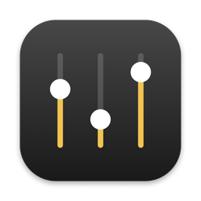
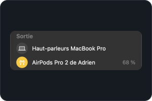

<p align="center"><picture>
  <source media="(prefers-color-scheme: light)" srcset="docs/assets/hero-light.svg">
  
</picture></p>

<p align="center"></p>

<h1 align="center">BetterSound</h1>

<p align="center"><b>Ползунок громкости для каждого приложения прямо в меню «Звук» от Apple.</b><br>
BetterSound заменяет пункт «Звук» в строке меню и в Пункте управления, выглядит так же и добавляет громкость, отключение звука и выход для каждого приложения.</p>

<p align="center">
  <a href="https://github.com/adrbn/bettersound/releases/latest/download/BetterSound.dmg"></a>
  <a href="#возможности"></a>
  <a href="#как-это-работает"></a>
  <a href="https://ko-fi.com/adrbn"></a>
</p>

<p align="center">
  
  
  
  
  
</p>

<p align="center">Бесплатно и с открытым кодом · бесплатная альтернатива Native Sound Mixer · английский и французский</p>

<p align="center"><sub><a href="README.md">English</a> · <a href="README.fr.md">Français</a> · <a href="README.de.md">Deutsch</a> · <a href="README.es.md">Español</a> · <a href="README.it.md">Italiano</a> · <b>Русский</b> · <a href="README.zh-CN.md">简体中文</a></sub></p>

---

В macOS одна громкость на всё. BetterSound даёт каждому приложению свой ползунок, отключение звука и выход в привычном меню: он занимает место «Звука» в строке меню, открывается при нажатии на «Звук» в Пункте управления и повторяет оформление Apple вплоть до строк устройств. Без аудиодрайвера, без расширения ядра, без настройки.

## Что он делает

<table>
  <tr>
    <td width="33%"><br><b>Ползунок для каждого приложения</b><br>У каждого играющего приложения своя строка.</td>
    <td width="33%"><br><b>Отключение в один клик</b><br>Нажмите на значок приложения.</td>
    <td width="33%"><br><b>Свой выход</b><br>Звонок в AirPods, фильм в динамиках.</td>
  </tr>
  <tr>
    <td><br><b>Заряд AirPods</b><br>Рядом с устройством, как у Apple.</td>
    <td><br><b>Значок следует за выходом</b><br>Те же символы, что в меню «Звук» Apple.</td>
    <td><br><b>Маленький и нативный</b><br>Core Audio taps, SwiftUI, ничего не ставится в систему.</td>
  </tr>
</table>

## Возможности

**Для каждого приложения**
- Ползунок громкости для каждого приложения, которое воспроизводит звук. Вспомогательные процессы и консольные плееры относятся к приложению, которое их запустило.
- Нажмите на значок приложения, чтобы отключить звук; потяните ползунок, чтобы вернуть.
- Отправьте приложение на другой выход кнопкой в конце строки. Если устройство отключится, приложение играет на системном выходе и возвращается, когда устройство появится.
- Приложения на 100 % на системном выходе не затрагиваются: ни tap, ни задержки.
- Громкость, отключение и выход запоминаются для каждого приложения.

**Меню «Звук» от Apple, заменённое**
- Занимает место пункта «Звук» Apple в строке меню; пункт Apple скрыт, пока работает BetterSound, и возвращается при выходе.
- Нажатие на «Звук» в Пункте управления открывает BetterSound. Ползунок громкости и кнопка AirPlay там продолжают работать.
- Значок показывает выход (AirPods, динамики, монитор) или уровень громкости, как у Apple.
- Список выходов с зарядом Bluetooth-устройств и ссылкой на настройки звука.
- Панель Liquid Glass, следующая светлой и тёмной теме.

**Приложение**
- Открывается при входе в систему. Правый клик по значку: автозапуск, проверка обновлений, GitHub, Ko-fi и выход.
- Автоматические обновления (Sparkle, подпись EdDSA).
- Английский и французский.

## Установка

1. Скачайте [BetterSound.dmg](https://github.com/adrbn/bettersound/releases/latest/download/BetterSound.dmg). Он подписан Developer ID и нотаризован Apple.
2. Перетащите BetterSound в «Программы» и откройте.
3. Разрешите **Универсальный доступ**, когда спросят, затем нажмите **Allow** в панели для системного звука.

Обновления приходят сами, или правый клик по значку → **Check for Updates…**.

## Требования

- macOS 26 Tahoe или новее.
- **Запись экрана и системного звука**, чтобы менять громкость каждого приложения. Ничего не записывается и не сохраняется.
- **Универсальный доступ**, чтобы открываться из «Звука» в Пункте управления.

## Как это работает

Core Audio process taps (`CATapDescription` с `.mutedWhenTapped`) отключают звук приложения у источника; приватное агрегатное устройство воспроизводит его звук с нужной громкостью на выбранном выходе. Это добавляет несколько миллисекунд задержки, только для изменённых приложений. Для Пункта управления BetterSound читает его раскладку через Универсальный доступ и превращает нажатие на модуль «Звук» в панель BetterSound.

Известное ограничение: если сменить выход вне BetterSound (кнопка AirPlay Apple или другое приложение), пока у приложения своя громкость, macOS может вернуть прежний. Из BetterSound всё работает.

## Сборка из исходников

```bash
brew install xcodegen
make build                     # ad-hoc
make install TEAM=XXXXXXXXXX   # Developer ID → /Applications
make release TAG=v0.1.1        # notarized DMG + Sparkle appcast
```

macOS сохраняет разрешение на звук между сборками только для подписанных сборок. Картинки README сделаны из настоящих снимков: `python3 docs/assets/make_svgs.py`.

## Конфиденциальность

BetterSound читает звук только чтобы изменить громкость и воспроизвести его. Ничего не записывается, не хранится и не отправляется. Единственный сетевой запрос — проверка обновлений в релизах этого репозитория.

## Поддержка

BetterSound бесплатный. Если он вам полезен, можете угостить меня кофе.

<p><a href="https://ko-fi.com/adrbn"></a></p>

## Лицензия

MIT: используйте, меняйте, распространяйте, сохраняйте уведомление. См. [LICENSE](LICENSE).

## Благодарности

[Sparkle](https://sparkle-project.org) для обновлений. Вдохновлено Native Sound Mixer и меню «Звук» от Apple.

<sub>BetterSound не связан ни с Apple, ни с Native Sound Mixer. macOS, AirPods и Пункт управления — товарные знаки Apple Inc.</sub>
