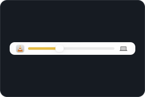
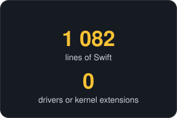

<p align="center"><picture>
  <source media="(prefers-color-scheme: light)" srcset="docs/assets/hero-light.svg">
  
</picture></p>

<p align="center"></p>

<h1 align="center">BetterSound</h1>

<p align="center"><b>每个 App 一个音量滑块，就在 Apple 的“声音”菜单里。</b><br>
BetterSound 取代菜单栏和控制中心里的“声音”，外观完全一致，并为每个 App 增加音量、静音和输出设备。</p>

<p align="center">
  <a href="https://github.com/adrbn/bettersound/releases/latest/download/BetterSound.dmg"></a>
  <a href="#功能"></a>
  <a href="#工作原理"></a>
  <a href="https://ko-fi.com/adrbn"></a>
</p>

<p align="center">
  
  
  
  
  
</p>

<p align="center">免费开源 · Native Sound Mixer 的免费替代品 · 英文和法文界面</p>

<p align="center"><sub><a href="README.md">English</a> · <a href="README.fr.md">Français</a> · <a href="README.de.md">Deutsch</a> · <a href="README.es.md">Español</a> · <a href="README.it.md">Italiano</a> · <a href="README.ru.md">Русский</a> · <b>简体中文</b></sub></p>

---

macOS 只有一个音量。BetterSound 让每个 App 拥有自己的滑块、静音和输出设备，就在你熟悉的菜单里：它占据菜单栏中“声音”的位置，在控制中心点按“声音”时打开，并沿用 Apple 的布局直到设备列表。无音频驱动，无内核扩展，无需设置。

## 它能做什么

<table>
  <tr>
    <td width="33%"><br><b>每个 App 一个滑块</b><br>每个正在播放的 App 都有自己的一行。</td>
    <td width="33%"><br><b>点按即静音</b><br>点按 App 图标即可静音。</td>
    <td width="33%"><br><b>独立输出设备</b><br>通话走 AirPods，电影走扬声器。</td>
  </tr>
  <tr>
    <td><br><b>AirPods 电量</b><br>显示在设备旁边，和 Apple 一样。</td>
    <td><br><b>图标跟随输出设备</b><br>与 Apple“声音”菜单相同的符号。</td>
    <td><br><b>小巧原生</b><br>Core Audio tap、SwiftUI，不向系统安装任何东西。</td>
  </tr>
</table>

## 功能

**按 App**
- 每个正在播放声音的 App 都有一个音量滑块。辅助进程和命令行播放器归入启动它们的 App。
- 点按 App 图标静音，拖动滑块取消静音。
- 用行尾的按钮把某个 App 发送到其他输出设备。设备断开时，App 改用系统输出，设备回来后自动切回。
- 在系统输出上保持 100% 的 App 完全不受影响：没有 tap，没有延迟。
- 音量、静音和输出设备按 App 记住。

**取代 Apple 的“声音”菜单**
- 占据菜单栏中 Apple“声音”的位置；BetterSound 运行时隐藏 Apple 的图标，退出后恢复。
- 在控制中心点按“声音”会打开 BetterSound。那里的音量滑块和 AirPlay 按钮照常可用。
- 菜单栏图标显示当前输出设备（AirPods、扬声器、显示器）或音量级别，和 Apple 一样。
- 输出设备列表带蓝牙电量，并链接到声音设置。
- Liquid Glass 面板，跟随浅色和深色模式。

**App**
- 登录时打开。右键点按图标：登录时打开、检查更新、GitHub、Ko-fi、退出。
- 自动更新（Sparkle，EdDSA 签名）。
- 英文和法文。

## 安装

1. 下载 [BetterSound.dmg](https://github.com/adrbn/bettersound/releases/latest/download/BetterSound.dmg)。已用 Developer ID 签名并经过 Apple 公证。
2. 把 BetterSound 拖到“应用程序”并打开。
3. 按提示允许 **辅助功能**，然后在面板中点按 **Allow** 以访问系统音频。

更新会自动到来，也可以右键点按图标 → **Check for Updates…**。

## 系统要求

- macOS 26 Tahoe 或更高版本。
- **录屏与系统录音**，用于调整每个 App 的音量。不会录制或保存任何内容。
- **辅助功能**，用于从控制中心的“声音”打开。

## 工作原理

Core Audio 进程 tap（`CATapDescription` 配合 `.mutedWhenTapped`）在源头静音一个 App；一个私有聚合设备按比例在所选输出设备上回放它的音频。这只会为你调整过的 App 增加几毫秒延迟。对于控制中心，BetterSound 通过辅助功能读取其布局，把对“声音”模块的点按变成 BetterSound 面板。

已知限制：当某个 App 有独立音量时，如果在 BetterSound 之外切换输出设备（Apple 的 AirPlay 按钮或其他 App），macOS 可能会切回原设备。在 BetterSound 内切换没有问题。

## 从源码构建

```bash
brew install xcodegen
make build                     # ad-hoc
make install TEAM=XXXXXXXXXX   # Developer ID → /Applications
make release TAG=v0.1.1        # notarized DMG + Sparkle appcast
```

只有签名的构建，macOS 才会在重新构建后保留音频权限。README 图片由真实截图生成：`python3 docs/assets/make_svgs.py`。

## 隐私

BetterSound 读取音频只是为了调整音量并回放。不录制、不保存、不发送任何内容。唯一的网络请求是从本仓库的 Releases 检查更新。

## 支持

BetterSound 是免费的。如果它对你有用，可以请我喝杯咖啡。

<p><a href="https://ko-fi.com/adrbn"></a></p>

## 许可证

MIT：可自由使用、修改、分发，保留版权声明即可。见 [LICENSE](LICENSE)。

## 致谢

更新使用 [Sparkle](https://sparkle-project.org)。灵感来自 Native Sound Mixer 和 Apple 的“声音”菜单。

<sub>BetterSound 与 Apple 及 Native Sound Mixer 均无关联。macOS、AirPods 和控制中心是 Apple Inc. 的商标。</sub>
